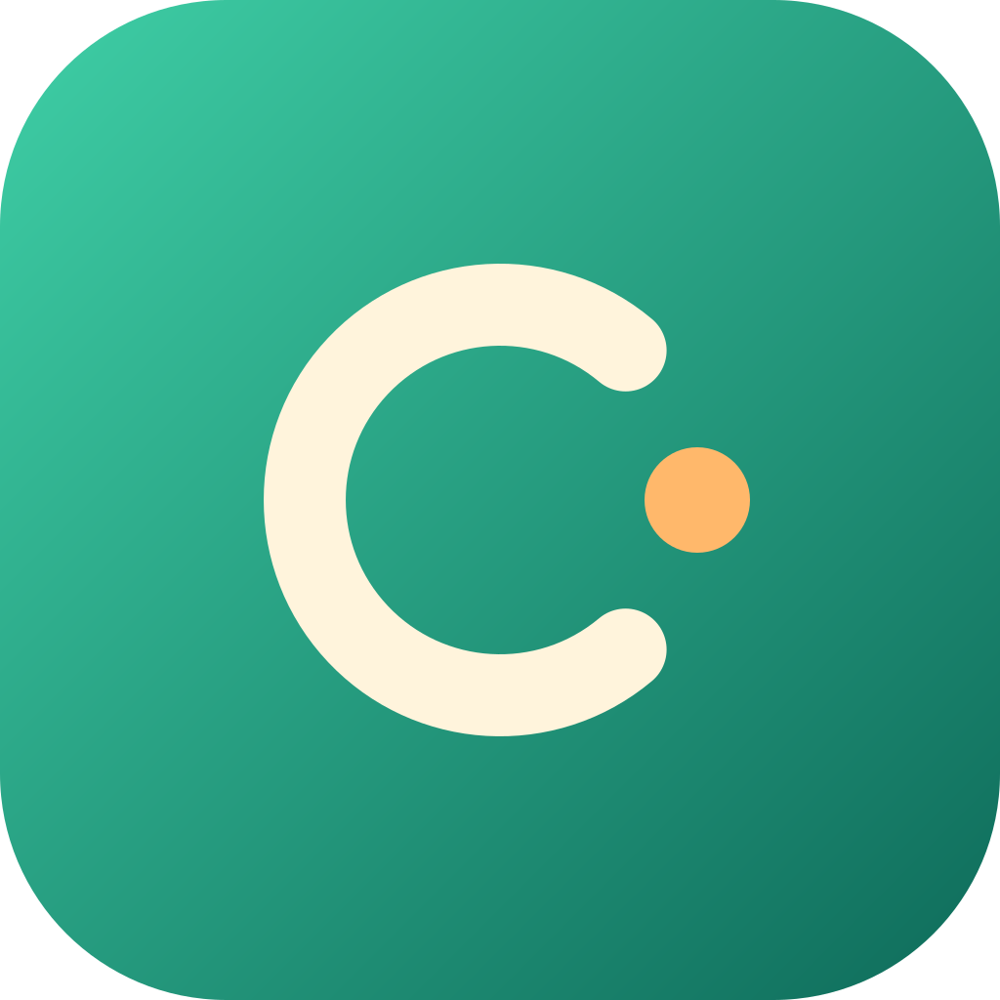

<div align="center">



# Carefree｜لوحة لا نهائية بالذكاء الاصطناعي للدراما القصيرة والدراما المصورة

أداة إبداع محلية بالذكاء الاصطناعي لصنّاع الدراما القصيرة والدراما المصورة والفيديوهات القصيرة: اكتب السيناريو، وقسّم اللقطات، وأدر الشخصيات والمشاهد، وأنشئ الصور والفيديوهات على لوحة لا نهائية.

[](../../LICENSE)


</div>

[简体中文](../../README.md) · [繁體中文](./readmeZhTw.md) · [English](./readmeEn.md) · [日本語](./readmeJa.md) · [Русский](./readmeRu.md) · [Tiếng Việt](./readmeVi.md) · [ไทย](./readmeTh.md) · [한국어](./readmeKo.md) · [हिन्दी](./readmeHi.md) · [Bahasa Indonesia](./readmeId.md) · [Bahasa Melayu](./readmeMs.md) · [Filipino](./readmeFil.md) · [বাংলা](./readmeBn.md) · [اردو](./readmeUr.md) · [தமிழ்](./readmeTa.md) · [తెలుగు](./readmeTe.md) · [मराठी](./readmeMr.md) · [ਪੰਜਾਬੀ](./readmePa.md) · [العربية](./readmeAr.md) · [فارسی](./readmeFa.md) · [Türkçe](./readmeTr.md)

Carefree أداة إبداع بالذكاء الاصطناعي تعمل محليًا بالكامل. تُحفظ المشاريع والمواد والمحادثات والنتائج المُنشأة على جهازك الخاص، ولا تُرسل أي بيانات استخدام إلى أي خادم. وتُعدّ خدمات النماذج بنفسك: أي واجهة متوافقة مع OpenAI، وComfyUI محلي، وخدمة TTS محلية أو مستضافة ذاتيًا.

## المزايا

| القدرة | الوصف |
| --- | --- |
| لوحة لا نهائية | نظّم السيناريو واللوحة القصصية والشخصيات والمشاهد ومقاطع الفيديو في لوحة واحدة، مع التجميع والربط. |
| الكتابة النصية | اتصل بأي واجهة نصية متوافقة مع OpenAI، واكتب السيناريو وإعدادات الشخصيات وأوصاف اللقطات في عقدة النص. |
| توليد الصور | أنشئ الصور الثلاثية للشخصيات والمشاهد والصور القصصية عبر سير عمل ComfyUI المستضاف ذاتيًا. |
| توليد الفيديو | أنشئ لقطات الفيديو عبر ComfyUI أو واجهات وسائط طرف ثالث، مع دعم مواد مرجعية متعددة وإلغاء التوليد. |
| توليد الصوت | اتصل بواجهة `/audio/speech` المتوافقة مع OpenAI؛ ويكون الدبلجة دون اتصال ممكنًا عند نشر TTS محليًا. |
| إدارة المواد | تدخل الصور والفيديوهات والصوتيات إلى مكتبة مواد واحدة، مع المعاينة والتنظيم والتنزيل. |
| المحلية أولًا | تستمع الخدمة افتراضيًا على الجهاز المحلي فقط؛ وعند تفعيل ربط الأجهزة حسب الحاجة يمكن المشاركة داخل الشبكة المحلية. |
| تعدد اللغات | تدعم الواجهة 21 لغة. |

تعتمد النماذج والدقة والمدة وقدرات الصوت المتاحة على المزوّد وسير العمل اللذين تعدّهما.

### سير العمل الإبداعي المعتاد

1. **السيناريو واللوحة القصصية**: نظّم القصة وإعدادات الشخصيات وأوصاف اللقطات بعقدة النص، وطوّرها بمساعدة نموذج اللغة.
2. **الشخصيات والمشاهد**: استورد صورًا مرجعية، أو أنشئ الشخصيات والمشاهد والصور القصصية عبر عقدة توليد الصور.
3. **لقطات الفيديو**: اربط النص والصور المرجعية، واختر نموذج الفيديو وطريقة التوليد، وأنشئ لقطة بلقطة.
4. **المعاينة والتصدير**: عاين الصور ومقاطع الفيديو ونظّمها في اللوحة، ونزّل المواد لمواصلة ما بعد الإنتاج.

## تثبيت العميل

| النظام | الوصف |
| --- | --- |
| Windows | شغّل حزمة التثبيت؛ يكتشف المثبّت WebView2 ويثبّته تلقائيًا. إذا تعطّل التطبيق عند فتحه بعد التثبيت، فثبّت [WebView2 Runtime](https://developer.microsoft.com/microsoft-edge/webview2/) يدويًا. |
| macOS (Apple Silicon) | اسحب Carefree إلى "Applications" وافتحه مباشرة. إذا ظهرت رسالة بأن المطوّر غير موثّق، فاسمح بفتحه من "System Settings → Privacy & Security". |

البروتوكول المستخدم هو `carefree://`، لإعادة التشغيل والتنقل عبر الروابط العميقة داخل العميل.

## التشغيل من المصدر

يتطلب [Bun 1.4.3](https://bun.sh/docs/installation).

```sh
git clone <رابط مستودعك> carefree
cd carefree
bun install --frozen-lockfile

# وضع التطوير: تشغيل Web وServer معًا
bun run dev
```

افتح `http://127.0.0.1:3000`. عند أول تشغيل تُهيّأ العقد والأدوات والإضافات المدمجة، ويُنشأ دليل العمل `myProject`.

### البناء

```sh
# بناء العقد والإضافات وWeb وServer
bun run build

# بناء مخرجات Server المستقلة
bun run build:server

# بناء عميل سطح المكتب
bun run build:desktop
bun run package:desktop
```

حزمة تثبيت Windows غير موقّعة افتراضيًا. قبل الإصدار، اضبط متغيرات البيئة التالية، وسيوقّع `bun run build:desktop` / `bun run package:desktop` تلقائيًا باستخدام `signtool` المشغّلات الأربعة (`startupLauncher.exe`، `protocolLauncher.exe`، `saveFileDialog.exe`، `updateHelper.exe`)، وبرامج المثبّت المساعدة (`checkWebView2.exe`، `checkRunning.exe`)، وملف `Setup.exe` النهائي، ثم يتحقق من التوقيع:

| المتغير | الوصف |
| --- | --- |
| `CAREFREE_SIGN_PFX` | المسار المطلق لشهادة `.pfx`؛ تُتخطى التوقيع عند عدم ضبطه |
| `CAREFREE_SIGN_PASSWORD` | كلمة مرور الشهادة؛ اتركها فارغة إذا كانت الشهادة غير مشفّرة |
| `CAREFREE_SIGN_TIMESTAMP_URL` | خدمة طابع زمني RFC3161، افتراضيًا `http://timestamp.digicert.com` |
| `SIGNTOOL_PATH` | مسار `signtool.exe`، يُبحث عنه تلقائيًا في Windows SDK افتراضيًا |

يتطلب بيئة Windows x64 وWindows SDK. يقع برنامج التطبيق الرئيسي داخل tar التحديث التراكمي، وهو خارج نطاق هذا التوقيع؛ وإذا لزم توقيعه، فوقّع ملف التطبيق أولًا ثم أعد إنشاء tar وقائمة التحديث.

في GitHub Actions، استخدم Secrets الخاصة بالمستودع لتوفير الشهادة؛ وبعد الإعداد، سيوقّع بناء Windows ويتحقق من التوقيع تلقائيًا:

| Secret | الوصف |
| --- | --- |
| `CAREFREE_SIGN_PFX_BASE64` | نص Base64 لملف شهادة `.pfx`؛ يتخطى CI التوقيع عند عدم إعداده |
| `CAREFREE_SIGN_PASSWORD` | كلمة مرور تصدير PFX؛ اتركها فارغة إذا لم تكن مشفّرة |

تُحفظ الشهادة مؤقتًا على القرص في خطوة البناء فقط، وتُحذف عند انتهاء المهمة. ويمكن تجاوز عنوان الطابع الزمني عبر متغير البيئة `CAREFREE_SIGN_TIMESTAMP_URL`.

### الخادم

```sh
bun run build:server
mkdir -p data/workspaces/myProject
bun run start:server
```

- يستمع افتراضيًا على `127.0.0.1:3000` ولا ينفتح على الشبكة الخارجية.
- يمكن تغيير المنفذ عبر `TOONFLOW_SERVER_PORT`.
- إن كنت تحتاج فعلًا إلى الوصول عبر الشبكة المحلية، فاضبط `TOONFLOW_SERVER_HOST=0.0.0.0` وحدّد المصادر بنفسك عبر جدار الحماية؛ ويُفضّل تفعيل "ربط الأجهزة" داخل التطبيق، فهو لا يستمع إلى منفذ منفصل إلا عند الحاجة.
- تُحفظ الإعدادات والإضافات ومساحة العمل افتراضيًا في `data/`. ويمكن الوصول إليها عند الاستخدام البعيد عبر نفق SSH:

```sh
ssh -N -L 3000:127.0.0.1:3000 user@server-address
```

## إعداد النماذج

افتح "Model service" في الإعدادات:

- **نموذج نصي**: أضف مزوّدًا متوافقًا مع OpenAI، وأدخل عنوان الواجهة وAPI Key وقائمة النماذج.
- **الصور / الفيديو**: ثبّت مزوّد ComfyUI وأعدّه، وأدخل عنوان ComfyUI المحلي وسير العمل.
- **الصوت**: ثبّت مزوّد TTS محليًا، والعنوان الافتراضي هو `http://127.0.0.1:8880/v1`، ويمكن توجيهه إلى أي خدمة متوافقة مع `/audio/speech`.
- **مزوّد مخصص**: يمكن استيراد ملف محوّل `.ts` في الإعدادات لتوسيع أي واجهة طرف ثالث.

يُحفظ API Key في دليل البيانات المحلي فقط، ولا يُرفع.

## Docker

يوفّر المستودع [Dockerfile](../../Dockerfile) و[Compose configuration](../../compose.yaml) و[build exclusion rules](../../.dockerignore)؛ وتعتمد الصورة على Bun 1.4.3 وتضمّ FFmpeg.

```sh
docker compose up -d --build
```

- يمكن الوصول إلى `http://127.0.0.1:3000`.
- تُحفظ البيانات في volume مسمّى `toonflowData` (مثبّت على `/app/data/` داخل الحاوية)؛ ولا تُفقد البيانات عند إيقاف الحاوية أو إعادة إنشائها، لذلك لا تستخدم `docker compose down -v`.
- تستمع الخدمة داخل الحاوية على `0.0.0.0`، فاضبط مصادر الوصول عبر تعيين المنافذ أو الوكيل العكسي.

الأوامر الشائعة:

```sh
docker compose logs -f toonflow
docker compose stop
docker compose start
docker compose down
```

## البيانات والخصوصية

- لا يجمع التطبيق أي إحصاءات مجهولة أو بيانات قياس عن بُعد ولا يرفعها.
- تُحفظ المشاريع والمطالبات والمحادثات والمحتوى المُنشأ في دليل البيانات المحلي.
- لا تُرسل الطلبات إلى الواجهة المقابلة إلا بعد إعداد مزوّد النماذج؛ ويخضع محتوى الطلب لشروط خدمة ذلك المزوّد.
- التحديث التلقائي معطّل افتراضيًا، ويمكن إعداد مصدر تحديث مستضاف ذاتيًا في الإعدادات.

## الترخيص مفتوح المصدر

Carefree تطوير مشتق من [Toonflow](https://github.com/HBAI-Ltd/Toonflow-app) ويتبع [MIT License](../../LICENSE). وتتبع الاعتماديات والمواد التابعة لطرف ثالث تراخيصها وإشعارات حقوق النشر الخاصة بها.

## الشكر

شكرًا لمشروع Toonflow ومساهميه على الأساس مفتوح المصدر، وشكرًا لمشاريع مفتوحة المصدر مثل ComfyUI وBun وVue وElectrobun.
